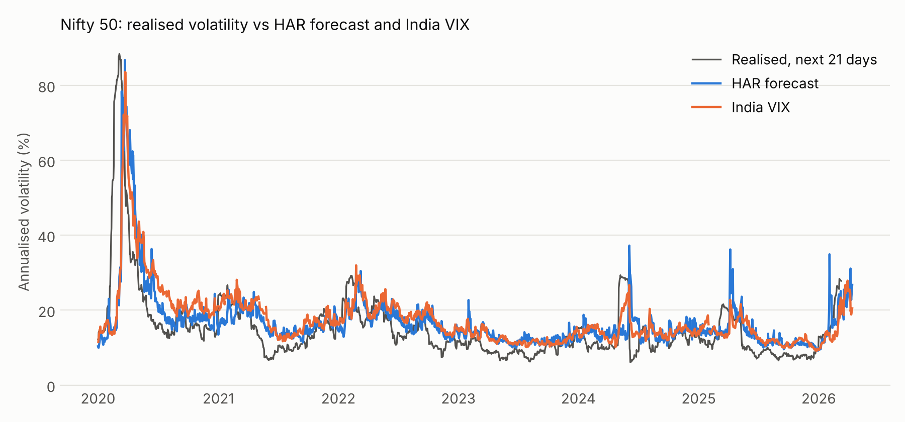

# ML For Economics: forecasting Nifty volatility and the SEBI 2024 F&O curbs

Term paper for AIL 7310 (Machine Learning for Economics), IIT Jodhpur, by Subham Agrawal.
Code is drafted with AI assistance, as the course requires; the author explains every part.

## Research questions

1. Does LightGBM forecast Nifty 50's 21-day realised volatility better than the HAR-RV benchmark and India VIX?
2. Did SEBI's November 2024 F&O curbs shrink the variance risk premium that option sellers earn?

A delta-hedged ATM straddle strategy, backtested on real NSE option prices, links the two:
it sells volatility only when VIX sits well above the model's forecast.

## First results (week 1)



Out-of-sample, Dec 2009 to Sep 2026 (n = 4,103; HAR refitted daily on an expanding window):

| Forecast | RMSE (vol pts) | QLIKE | MZ slope | Mean forecast | Mean realised |
| --- | --- | --- | --- | --- | --- |
| HAR, Garman-Klass inputs | 7.09 | 0.261 | 0.62 | 17.4% | 14.8% |
| HAR, close-to-close inputs | 6.92 | 0.260 | 0.66 | 17.1% | 14.8% |
| India VIX | 6.78 | 0.246 | 0.72 | 17.7% | 14.8% |

- India VIX beats HAR on both losses across 17 years, so the market's own forecast is the bar to clear.
- VIX averages 2.9 vol points above the volatility that follows: the variance risk premium the straddle strategy tries to earn.
- Garman-Klass range inputs do not improve HAR at a one-month horizon; close-to-close inputs do slightly better.
- All Mincer-Zarnowitz slopes are below 1: every forecast overreacts to recent volatility.

Significance tests (Diebold-Mariano) come with the ML model.

## Setup

```
pip install -r requirements.txt
```

## Run order

| Step | Command | What it does |
| --- | --- | --- |
| 1 | `python data.py` | Loads Nifty and VIX, prints data checks |
| 2 | `python features.py` | Builds HAR features and the 21-day target, prints a summary |
| 3 | `python report.py` | HAR fit, out-of-sample HAR vs VIX, writes `output/` and `figures/` |
| 4 | `python test_week1.py` | Checks target alignment, no look-ahead, Black-76, bhavcopy parsing |

Data downloads (need access to Yahoo Finance and nseindia.com):

| Step | Command | What it does |
| --- | --- | --- |
| A | `python -c "import data; data.download_yahoo()"` | Replaces the raw CSVs with full history (VIX back to 2008) |
| B | `python options.py download 2016-01-01 2026-10-21` | Downloads daily F&O bhavcopy zips into `data/bhavcopy/` (about an hour) |
| C | `python options.py` | Builds the daily ATM straddle and implied vol; saves `data/processed/atm_straddle.csv` (about 15 min) |

## Files

| File | Role |
| --- | --- |
| `data.py` | Loads and cleans Nifty OHLC and India VIX into one table |
| `features.py` | Close-to-close and Garman-Klass variance, HAR terms, forward 21-day target |
| `models.py` | HAR with Newey-West errors, expanding-window walk-forward, RMSE, QLIKE, Mincer-Zarnowitz |
| `options.py` | NSE bhavcopy download and parsing (old and UDiFF layouts), Black-76, ATM implied vol |
| `report.py` | Runs the pipeline; writes tables to `output/` and figures to `figures/` |
| `test_week1.py` | Checks target alignment, no look-ahead, put-call parity and both bhavcopy layouts |

## Data

- Nifty 50 daily OHLC (Yahoo ^NSEI), 17 Sep 2007 to 22 Oct 2026.
- India VIX daily (Yahoo ^INDIAVIX), 3 Mar 2008 to 22 Oct 2026.
- Spot checks against NSE closes: Nifty 4 Jun 2024 = 21,884.50; India VIX = 26.75.
- NSE F&O bhavcopy, Jan 2016 to Oct 2026 (raw zips not committed; regenerate with step B).
  The daily ATM table built from them is committed as `data/processed/atm_straddle.csv`.

## Status

- [x] Week 1: data, features, HAR, first figure, tests
- [x] VIX back-fill to 2008; bhavcopy download, checked on real files of both layouts
- [ ] Build and commit the daily ATM implied vol table (step C)
- [ ] Week 2: LightGBM, Diebold-Mariano test, ATM implied vol series
- [ ] Week 3: straddle backtest on real prices, SEBI before/after test, write-up
- [ ] Week 4: VaR and ES with Kupiec test, Streamlit page, talk
